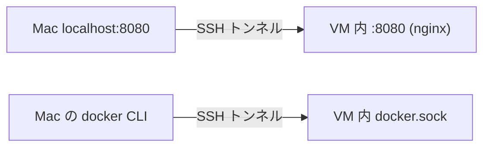

## TL;DR
- Apple 純正の [container](https://github.com/apple/container) の `container machine` で長期稼働する Linux VM を立て、その中で Docker を動かせば **Docker Desktop なしで `docker compose` が動く**
- ただし `container machine` にはポート公開（`--publish`）が無いため、そのままでは **localhost で繋がらない**
- **ssh ポートフォワーディング**でポートと `docker.sock` を Mac 側に転送すれば、localhost も Mac の `docker` コマンドもそのまま使える
- 結果として、構成は「ほとんど WSL2」になる

:::note
本記事は社内 LT（2026-09）で発表した内容をブログ向けに再構成したものです。
:::

## 背景

### Mac で docker compose といえば？
Mac で `docker compose` を使うなら、これまでのデファクトスタンダードは **Docker Desktop** でした。
ただし Docker Desktop は、一定規模以上の企業で利用する場合は[有償プラン](https://www.docker.com/pricing/)が必要です。

一方で、Apple は Mac 用のコンテナ実行環境として [container](https://github.com/apple/container) を OSS で公開しています。
今回はこの **Apple 純正の container** だけで、Docker Desktop を置き換えられないか試してみました。

### Apple container とは
Apple container は、Mac 上で Linux を軽量 VM として動かす Apple 謹製のツールです。
使い方は大きく 2 つあります。

| | `container run` | `container machine` |
| --- | --- | --- |
| 位置づけ | コンテナ 1 つ = 専用の軽量 VM | 長期稼働する汎用 Linux VM |
| 用途 | `docker run` のような単発実行 | Ubuntu を入れて `apt` も `docker` も使える |

どちらも共通して、ホストとは virtiofs でファイルを共有し、VM ごとに専用の IP が振られます。

今回使うのは **`container machine`** の方です。
VM の中に Docker Engine を入れてしまえば、普段どおり `docker compose` が使えるはず……という目論見です。

## 問題：localhost で繋がらない

ところが、ここで壁にぶつかります。

- ポート公開のオプション `--publish` があるのは **`container run` だけ**で、**`container machine` には無い**
- VM の IP（`192.168.64.x`）を直接叩けば届く。**でも localhost ではない**
- Docker のソケットも VM の中だけ。**Mac の `docker` コマンドからは使えない**

### localhost 以外だと、アプリが壊れる
「IP 直打ちで届くならいいのでは？」と思うかもしれません。
しかし開発用の設定は「アクセス元は localhost」前提になっていることが多く、たとえば以下のような設定に影響が出ます。

- ホスト許可
- Cookie のドメイン
- リダイレクト先 URL

実際、私のチームで開発中の Rails + Vite アプリでは、特定のドメインか localhost 以外からの Referer を reject する設定になっており、IP 直打ちではアクセスできませんでした。
`/etc/hosts` でそのドメインを VM の IP に向ける手もありますが、そうすると今度はアプリ側の設定ファイル等の変更が必要になります。

開発環境のためにアプリの設定をいじるのは本末転倒なので、**Mac の localhost でそのまま繋がる**ようにしたいところです。

## 解決策：ssh ポートフォワーディング

そこで使うのが、昔ながらの **ssh ポートフォワーディング**です。

```bash
mkdir -p ~/.cache/container-machine-compose
ssh -f -N \
  -L 127.0.0.1:8080:localhost:8080 \
  -L ~/.cache/container-machine-compose/devbox-docker.sock:/var/run/docker.sock \
  <user>@<VM_IP>
```

この ssh コマンド 1 つで、以下の 2 つのトンネルを張っています。



- 1 本目の `-L` は TCP ポートの転送です。Mac の `localhost:8080` へのアクセスが VM 内の `:8080` に届きます
- 2 本目の `-L` は Unix ドメインソケットの転送です。Mac 側の `~/.cache/container-machine-compose/devbox-docker.sock` が VM 内の `/var/run/docker.sock` に繋がります
- `-f` でバックグラウンド実行、`-N` でリモートコマンドを実行せずトンネルだけを張ります

VM に sshd と公開鍵を入れておけば、**Mac 標準の ssh だけで、localhost と docker コマンドの両方を繋げられる**点がポイントです。追加のツールは不要です。

### Mac の docker CLI から VM の Docker を使う
転送したソケットを Docker CLI から使うには、`docker context` を作っておくと便利です。

```bash
docker context create cm-devbox \
  --docker "host=unix://$HOME/.cache/container-machine-compose/devbox-docker.sock"
docker context use cm-devbox
```

これで、Mac で打った `docker` / `docker compose` コマンドの向き先が、すべて VM 内の Docker Engine になります。

後述のキットの `tunnel.sh` では、この context の作成までを自動で行っています。

:::note
Mac 側には Docker Desktop ではなく、Docker CLI（と compose プラグイン）だけをインストールしておけば OK です。
:::

## 実践：あなたの Mac でも試せる

VM の作成からトンネルの張り直しまでをスクリプトにまとめ、サンプルアプリ（nginx + API）付きのキットとして公開しました。

https://github.com/Junm0ri/container-machine-compose

### 前提
- Apple silicon の Mac（macOS 26）
- [container](https://github.com/apple/container/releases) CLI がインストール済み
- SSH の鍵ペア（`~/.ssh/id_ed25519.pub` など）
- Mac の `docker` コマンドから使う場合は、Docker CLI（`brew install docker docker-compose`）

動作確認環境は macOS 26.6.2 / container CLI 1.0.0 です。

### 一連の流れ

キットは、ホームディレクトリ配下の空白を含まないパスに clone してください。

```bash
git clone https://github.com/Junm0ri/container-machine-compose.git ~/container-machine-compose
cd ~/container-machine-compose
./setup.sh                    # VM を作成、Docker と SSH 鍵を設定
./tunnel.sh                   # ポートと docker.sock を転送
docker context use cm-devbox
docker compose up -d          # Mac から実行、VM の中で動く
open http://localhost:8080    # ホストから VM 内の Web サーバーにアクセス！
```

`docker compose up -d` は Mac 上で実行していますが、コンテナが動いているのは VM の中です。
そして、ブラウザからは `http://localhost:8080` でアクセスできます。
LT のライブデモでも、この流れで VM 内の Web サーバーに localhost からアクセスできることを確認しました。

主なスクリプトの役割は以下のとおりです。

- `setup.sh`：イメージのビルド → `container machine` の作成 → VM 内の Docker と SSH の初期設定までを行います。何度実行しても問題ありません
- `tunnel.sh`：Mac の `localhost:<port>` と Docker ソケットを SSH で VM に転送し、`docker context`（`cm-devbox`）も作成します。VM の IP が変わっていれば張り直します。`./tunnel.sh stop` / `./tunnel.sh status` で停止・状態確認もできます

自分のプロジェクトで使う場合は、`docker-compose.yml` を置き換えて、Mac に転送したいポートを `TUNNEL_PORTS` に並べてください（例：`TUNNEL_PORTS="3000 5173" ./tunnel.sh`）。
設定項目やハマりどころ、片付け方法はリポジトリの README にまとめています。

:::note
`compose.yml` で bind mount を使う場合、マウント元のパスは VM から見たパスとして解釈されます。
ホームディレクトリ配下は virtiofs で同じパスのまま共有されているのでそのまま動きますが、ホームの外（`/tmp` など）は VM から見えないため空になります。
:::

## 結果：ほとんど WSL

出来上がった構成を WSL2 と比べてみると、驚くほど似ています。

| | WSL2 | 今回の構成 |
| --- | --- | --- |
| Linux VM | Hyper-V | container machine |
| ファイル共有 | `/mnt/c` | virtiofs（同一パス） |
| localhost | localhostForwarding | SSH トンネル |
| 成熟度 | OS 標準機能 | 発展途上・自前管理 |

まさに「**Mac 版 WSL**」と呼べる構成になりました。

### 注意点
- SSH トンネルは公式機能ではありません
  - 将来 `container machine` にポート公開の機能が来れば、不要になるかもしれません
- まだあまり深いところまでは触れていません
  - WSL と同等ではない機能制限があるかもしれません

## まとめ
- **Apple 純正ツールだけで `docker compose` が動く**
- **localhost の壁は ssh ポートフォワーディングで解決**
- **Mac の `docker` コマンドもそのまま使える**

Docker Desktop のライセンスが気になっている方は、ぜひ試してみてください。
